# TUGAS AFL-1 WEB DEVELOPMENT
## Personal Branding Website - Galang Reisduanto

Website personal branding berbasis Laravel 11 dengan desain Slush Neobrutalism (Inflatable Sticker Universe on Pastel Paper). Dibangun untuk memenuhi tugas AFL-1 mata kuliah Web Development di Universitas Ciputra Surabaya.

---

## Cara Instalasi (How to Install)

### Prasyarat

- PHP 8.2 atau lebih baru (disarankan PHP 8.3+)
- Composer 2.x
- Node.js 18+ dan NPM
- Git

### Langkah Instalasi

1. Clone repository:
   ```bash
   git clone https://github.com/galang-rs/afl1-webdev.git
   cd afl1-webdev
   ```

2. Instal dependensi PHP:
   ```bash
   composer install
   ```

3. Instal dependensi frontend:
   ```bash
   npm install
   ```

4. Konfigurasi environment:
   ```bash
   cp .env.example .env
   php artisan key:generate
   ```

5. Build aset frontend:
   ```bash
   npm run build
   ```

---

## Cara Menjalankan (How to Use)

1. Jalankan server Laravel:
   ```bash
   php artisan serve
   ```

2. Buka browser ke `http://127.0.0.1:8000`

3. Untuk mode development dengan Hot Module Replacement:
   ```bash
   npm run dev
   ```
   Lalu buka terminal baru dan jalankan `php artisan serve`.

### Daftar Halaman

| Halaman | URL | Keterangan |
|---|---|---|
| Home | `/` | Beranda dengan hero, statistik, dan ringkasan |
| About | `/about` | Profil, keahlian, pendidikan, pengalaman |
| Portfolio | `/portfolio` | Galeri 6 proyek nyata dari GitHub |
| Portfolio Detail | `/portfolio/{slug}` | Detail studi kasus per proyek |
| Blog | `/blog` | Katalog 6 artikel dengan pencarian dan filter |
| Blog Detail | `/blog/{slug}` | Artikel lengkap dengan sidebar |
| Contact | `/contact` | Saluran komunikasi resmi, WhatsApp, email, dan direktori media sosial |

---

## Tampilan Website (Proof of Website)

### Konsep Desain: Slush Neobrutalism

Website menggunakan gaya visual **Slush - Inflatable Sticker Universe on Pastel Paper** dengan karakteristik:
- Kanvas pastel lembut (Sky Wash, Lavender, Mint, Sunburst)
- Border hitam tegas 1px pada setiap kartu, tombol, dan badge
- Tipografi display besar dengan font Instrument Sans dan Antonio
- Elemen dekoratif 3D inflatable (pita tubular, stiker warna-warni)
- Tipografi fluid menggunakan `clamp()` sehingga ukuran font menyesuaikan secara mulus dari mobile ke desktop
- Sistem navigasi SPA (Single Page Application) berbasis Fetch API dan History API, menghilangkan kedipan reload browser saat berpindah halaman dan mempercepat transisi rute dengan progress bar dinamis

### Desktop (1440px)

#### Home
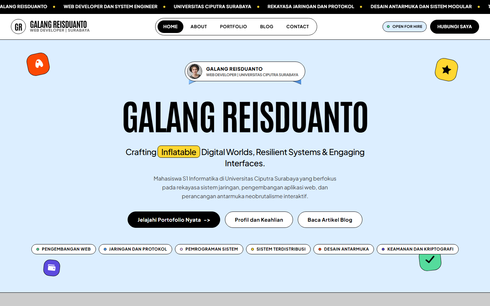

#### About
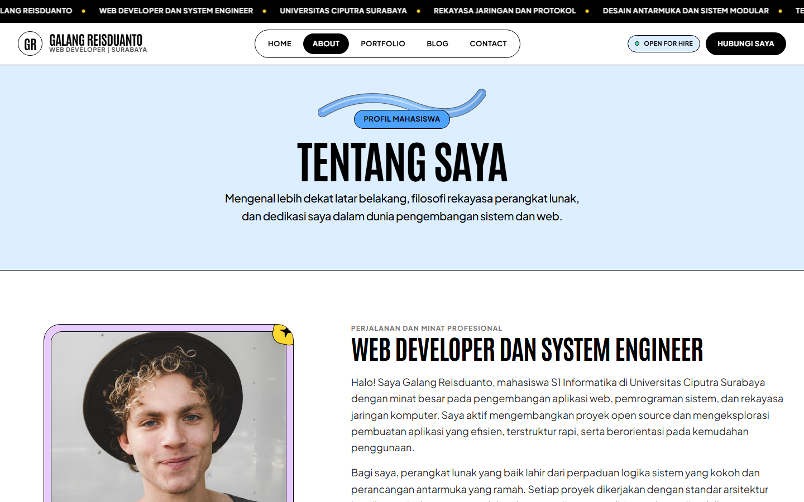

#### Portfolio
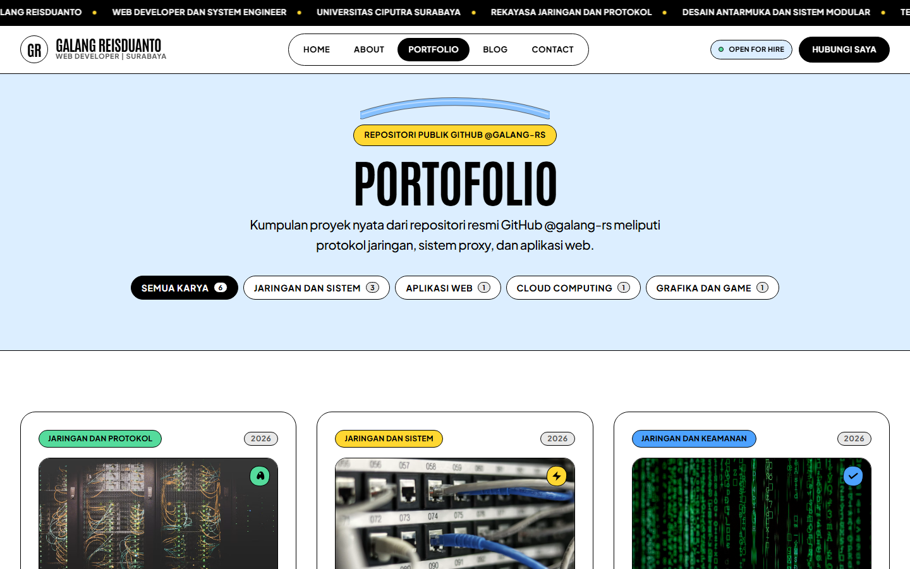

#### Portfolio Detail
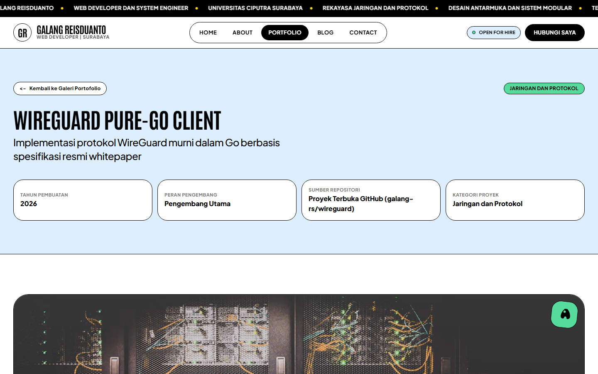

#### Blog
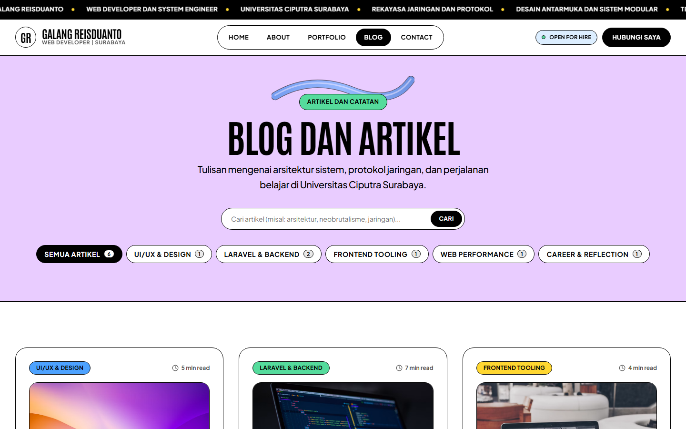

#### Blog Detail
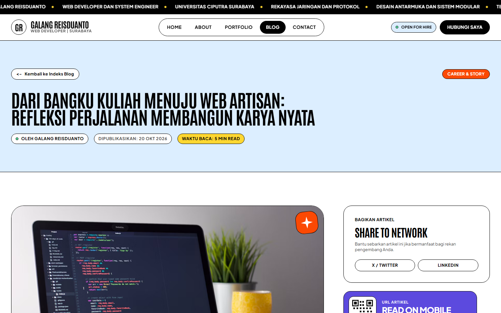

#### Contact
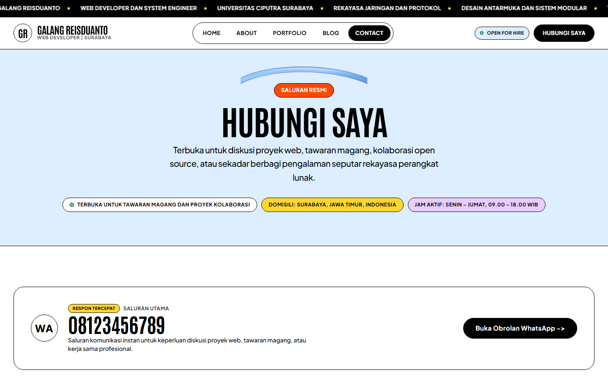

### Mobile (375px)

| Home | About | Portfolio |
|:---:|:---:|:---:|
| 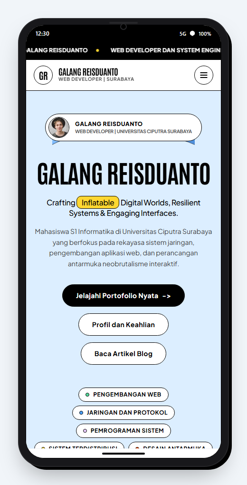 | 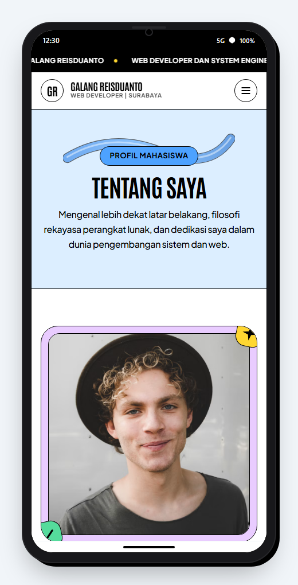 | 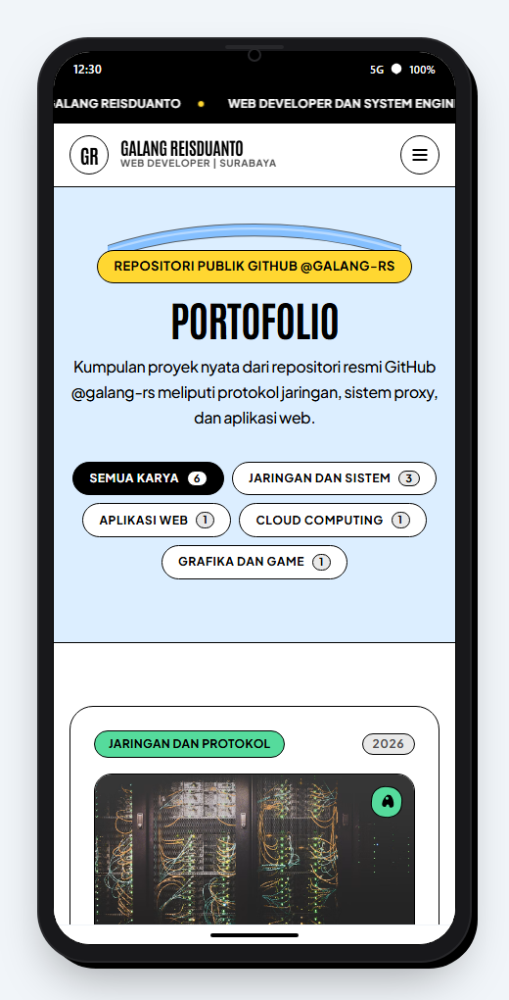 |

| Portfolio Detail | Blog | Blog Detail | Contact |
|:---:|:---:|:---:|:---:|
| 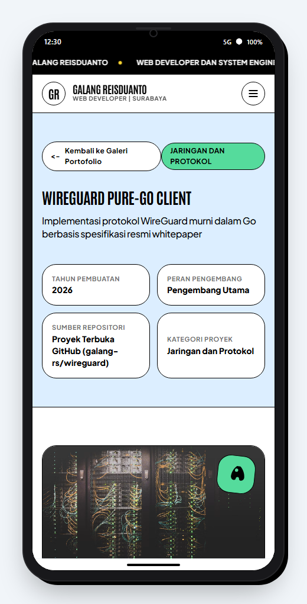 | 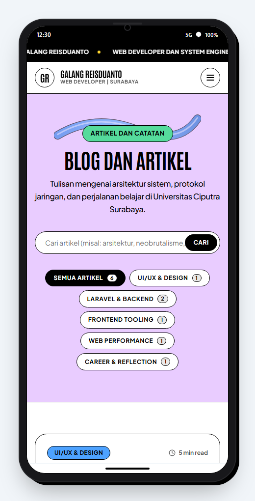 | 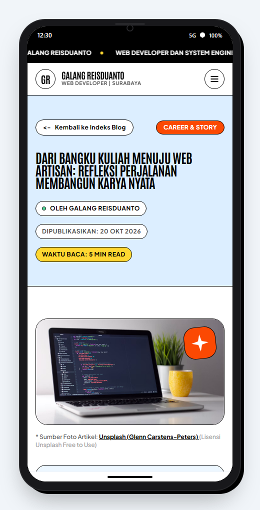 | 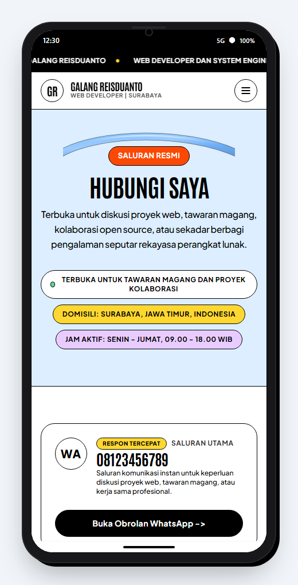 |

---

## Sumber Gambar (Image Sources)

Seluruh foto yang digunakan bersumber dari **Unsplash** dengan lisensi **Unsplash License (Free to Use)**.

### Foto Profil

| Kegunaan | Fotografer | Link Sumber |
|---|---|---|
| Foto profil Galang (Home, About, Blog Author) | Jurica Koletic | https://unsplash.com/photos/7YVZYZeITc8 |

### Foto Portfolio

| Proyek | Fotografer | Link Sumber |
|---|---|---|
| wireguard (Pure Go Client) | Markus Spiske | https://unsplash.com/photos/iar-afB0QQw |
| socks5 (Modular Proxy Server) | Alina Grubnyak | https://unsplash.com/photos/ZiQkhI7417A |
| ovpn (OpenVPN Client) | FlyD | https://unsplash.com/photos/iar-afB0QQw |
| web-programing-afl4 | Glenn Carstens-Peters | https://unsplash.com/photos/nLU4vO5iCEQ |
| AFL2-Cloud-Computing | Campbell | https://unsplash.com/photos/2x1qbYvDOGI |
| game-car (Simulasi Balapan) | Carl Raw | https://unsplash.com/photos/m3hn2Kn5Bns |

### Foto Artikel Blog

| Artikel | Fotografer | Link Sumber |
|---|---|---|
| Neobrutalism dalam Desain Web Modern | Milad Fakurian | https://unsplash.com/photos/E8UjrkgMwFo |
| Arsitektur MVC di Framework Modern | Fatos Bytyqi | https://unsplash.com/photos/Agx5_TLsII4 |
| Modern Asset Bundling untuk Web | Christopher Gower | https://unsplash.com/photos/m_HRfLhgABo |
| Optimalisasi Performa Web | Carlos Muza | https://unsplash.com/photos/hpjSkU2UYSU |
| Dari Bangku Kuliah Menuju Web Artisan | Glenn Carstens-Peters | https://unsplash.com/photos/RLw-UC03Gwc |
| Merancang Antarmuka REST API | Markus Spiske | https://unsplash.com/photos/iar-afB0QQw |

---

## Pernyataan Penggunaan AI (AI Disclosure)

Sesuai ketentuan tugas AFL-1, penggunaan AI diperbolehkan sebagai alat bantu pembelajaran. AI digunakan sebagai asisten dalam perancangan struktur komponen Blade, konfigurasi token warna Tailwind CSS, dan pembentukan pola controller MVC. Seluruh alur program, pemetaan routing, dan logika kode telah dipelajari serta dipahami secara penuh oleh mahasiswa dan siap dipertanggungjawabkan pada sesi evaluasi.
